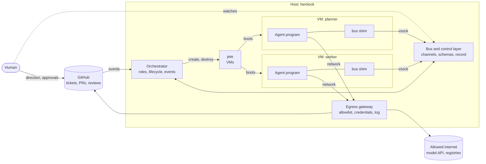

# Architecture

The big picture: which tools make up machinesdancing, what each one owns, how they connect, and the
order we build them in. [PRINCIPLES.md](../PRINCIPLES.md) says what must hold; this says how the
pieces fit together to make it hold. Each tool gets its own design doc when we build it, like
[jete.md](jete.md).

Only jete exists so far. Everything else here is a proposal, to be refined as we build.

## What we are building

A team of AI agents that works as a governed system. A human sets direction and holds final
authority. A planner agent turns direction into tickets. Worker agents each take a ticket, do the
work in their own VM and deliver it as a GitHub pull request. The rules of that practice (who may
talk to whom, what an agent may reach, what needs a human's approval) are enforced by the tools
around the agents, not by asking the agents to follow them.

## The picture

Agents never talk to each other or to the outside directly. Each VM has exactly two ways out,
both on the host: its vsock channel to the bus, and its network link to the gateway.

## The tools

Each tool does one job, is usable on its own and knows nothing about the layers above it
(principle 2).

| Tool | Job | Knows nothing about | Status |
|---|---|---|---|
| **jete** | Runs VMs: images, isolation, disks, a vsock channel per VM, and a network link that reaches only the addresses it's given. | Agents, messages, roles, GitHub. | M1 done. |
| **Egress gateway** | Every connection a VM makes to the outside world: checks the destination's name against the VM's allowlist, adds credentials to approved requests, logs every request. | VMs' internals, agents, messages. It sees connections and a policy per source. | Not designed. |
| **Bus and control layer** | Every message between agents, and between agents and the system: delivers it only over a declared channel, checks it against its schema and rules, rejects it with a reason, records it. | VMs and networking. It sees authenticated senders and messages. | Not designed. |
| **Orchestrator** | Roles, the work lifecycle, spawning and destroying agents, waking them on GitHub events, the human approval flow. Composes the other tools. | How VMs, connections or messages are implemented. | Not designed. |

Configuration that ties them together (roles, channels, schemas, allowlists, procedures) lives in
git as declarative files (principle 15). The orchestrator reads it and hands each tool its part:
a VM spec to jete, an allowlist to the gateway, channels to the bus.

## How a piece of work flows

1. The human writes direction as a GitHub issue, or asks the planner.
2. The planner turns it into tickets on GitHub (principle 9: the record lives there).
3. The orchestrator sees a ready ticket and spawns a worker for it (principle 14):
   - jete boots a VM from the worker role's image, with a network link to the gateway only;
   - the gateway gets the role's allowlist and credentials for that VM;
   - the bus gets the role's channels for that VM.
4. The agent program starts in the VM with its task. It works in its own clone, which it gets
   from GitHub through the gateway (principle 10).
5. It talks only through the bus: asks the planner a question, reports progress. Each message
   points at a GitHub artifact and cites its evidence (principles 9, 11).
6. It opens a pull request. The orchestrator moves the ticket to *review* and does the
   bookkeeping (principle 13).
7. A review or CI result on GitHub wakes the right agent through the orchestrator.
8. The human approves and merges. Agents' credentials cannot merge (principle 8).
9. The orchestrator destroys the VM, and its access goes with it.

## Where the tools meet

| Boundary | Mechanism | Why |
|---|---|---|
| Host to VM, control | vsock, port 1024: `jete-agent` runs commands (jete's own channel). | Needs no network. Only the host can connect. |
| Agent to bus | vsock, its own port. Inside the VM, a small **bus shim** presents the bus to the agent program as an **MCP server** (tools such as "send a message", "read my inbox"). | The host knows which VM a vsock connection comes from, so the bus knows the sender's identity without trusting anything the agent says (principle 7). MCP is what agent programs already speak. |
| VM to outside | A network link (jete's tap device) that reaches only the gateway. The gateway receives connections transparently: no proxy settings in the guest. | Enforced by the firewall, so an agent that ignores proxy settings still can't get around it (principle 1). |
| System to GitHub | GitHub's API, with credentials held by the gateway and the orchestrator, never by agents. Branch protection keeps merges for the human. | GitHub is the record (principles 9, 10). |
| Configuration | Files in git, read by the orchestrator. | Declarative (principle 15). |

## Agent programs are interchangeable

The harness doesn't depend on which agent program runs in a VM: Claude Code, OpenCode, or
something else. An agent program only has to:

- run on Linux inside the guest image;
- use MCP tools (for the bus);
- reach its model over HTTPS (through the gateway, like everything else).

Which program a role uses is configuration: the image it boots and the command that starts it.
Credentials for the model API are, ideally, added by the gateway, so the agent never holds a key it
could leak. Where a program insists on a local credential, that role gets the narrowest one
available, and the gateway still limits where it can be used.

## The egress gateway

The VM's network link reaches only the gateway; the gateway decides what goes further.

- **By name, not address.** For HTTPS it reads the name the client asks for (TLS SNI), and for
  HTTP the `Host` header, then checks it against the VM's allowlist. It doesn't decrypt TLS, so
  rules apply to whole hosts, not URL paths, until something needs more.
- **It answers the guest's DNS too.** Allowed names resolve; anything else is refused without
  being forwarded, so DNS can't be used to leak data. The gateway decides each connection by the
  name it asks for and connects to that name itself, so a CDN address shared with other sites
  doesn't let those sites in.
- **Credentials.** For allowed hosts that need them (the model API, GitHub), the gateway adds the
  credential to requests. That needs it to terminate TLS for those hosts with a certificate the
  guest image trusts; for every other host it only passes bytes through.
- **Everything is logged** (principle 16).
- **Non-HTTP traffic** (git over SSH, raw TCP) is not supported by name. Where a role needs it,
  jete's address allowlist lets it through to specific addresses.

## The bus and control layer

- **Channels are configuration.** Who may send what type of message to whom. Anything else is
  rejected (principles 4, 5).
- **Messages are typed.** Each type has a schema. A message that breaks its schema or a rule is
  rejected with a reason the sender can act on (principle 6).
- **Messages are notifications.** They point at GitHub artifacts; the record is on GitHub
  (principle 9).
- **Identity comes from the connection,** not the message (principle 7). Authority does not travel
  with a message: an agent can't get another agent to do what it was denied.
- **Everything is recorded** and visible to the human (principle 16).

## Trust

| Trusted | Not trusted |
|---|---|
| The host, its kernel, and the tools on it (jete, the gateway, the bus, the orchestrator). | Everything inside a VM: the agent program, the code it runs, the guest kernel. |
| Configuration in git, after human review. | Anything an agent says about itself or another agent. |
| GitHub, for the record and for the human's approvals. | |

The hypervisor is the boundary (principle 3). Every path out of a VM ends at a host tool that
checks it.

## Build order

The aim is a thin end-to-end slice early (one worker, one ticket, one PR), then widening.

| Step | Delivers |
|---|---|
| 1. jete M2: Network | A VM's network link reaches only the addresses it's given, and nothing on the host, the LAN, the tailnet or other VMs. No allowlist by name in jete: that is the gateway's job. |
| 2. Egress gateway | Allowlist by name, logging. Then credential injection. |
| 3. One agent in a VM | An agent program (Claude Code or OpenCode) in a guest image, reaching its model through the gateway, doing a task started by hand. |
| 4. Bus | The shim and the host bus, with channels and schemas from configuration. |
| 5. Orchestrator | Roles, spawning on tickets, GitHub events, the lifecycle. The first end-to-end slice. |
| 6. jete M3, M4 | The daemon, then speed (snapshots, a warm pool), when spawning on demand needs them. |

## Open questions

1. **Names.** jete is named; the gateway, the bus and the orchestrator are not.
2. **GitHub events on hemlock.** Webhooks need a reachable endpoint; hemlock is on a home network.
   Options: polling, a relay, or GitHub Actions calling in over Tailscale.
3. **Model access.** Claude Code with a Claude subscription, or any agent program with an API key.
   Check the subscription's terms for use from VMs and with third-party programs.
4. **One host or many.** Everything above runs on hemlock. Nothing prevents more hosts later, but
   nothing plans for them yet.
5. **The human's view.** How the record of messages and decisions is shown (principle 16): GitHub
   alone, or a dashboard.
