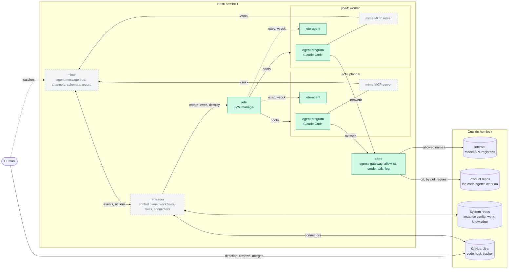

# Architecture

The big picture: which tools make up machinesdancing, what each one owns, how they connect and
where things are stored. [PRINCIPLES.md](../PRINCIPLES.md) says what must hold; this says how the
pieces fit together to make it hold. Each tool gets its own design doc when we build it, like
[jete.md](design/jete.md) and [barre.md](design/barre.md).

jete and barre exist, and Claude Code runs in a VM behind them, working on a repo as a GitHub App
and delivering pull requests that the human merges, with barre setting its credentials so the VM
holds none (steps 1 to 5 of the [build order](build-order.md), which says what comes next). mime and regisseur are a starting
design, to evolve as we build them.

## What we are building

A team of AI agents that works as a governed system. A human sets direction and holds final
authority. A planner agent turns direction into tickets. Worker agents each take a ticket, do the
work in their own VM and deliver it as a pull request. The rules of that practice (who may talk to
whom, what an agent may reach, what needs a human's approval) are enforced by the tools around the
agents, not by asking the agents to follow them. Routine steps (updating branches, moving tickets,
syncing clones) are done by the system, not by agents told to remember them.

## The picture

Green: built. Grey, dashed: designed, not built yet.

Agents never talk to each other or to the outside directly. Each VM has exactly two ways out,
both on the host: its vsock channel to the bus, and its network link to the gateway. jete's own
vsock channel to `jete-agent` is a way in, and only the host can use it.

## The tools

Each tool does one job, is usable on its own and knows nothing about the layers above it
(principle 2).

| Tool | Job | Knows nothing about | Status |
|---|---|---|---|
| **jete** | Runs VMs: images, isolation, disks (including extra read-only ones), a vsock channel per VM, and a network link that reaches only the addresses it's given. | Agents, messages, roles, workflows, GitHub. | M1 and M2 done, with the egress proxy: [jete.md](design/jete.md). |
| **Egress gateway** (barre) | Every connection a VM makes to the outside world: checks the destination's name and port against the VM's allowlist, adds credentials to approved requests, logs every request. | VMs' internals, agents, messages. It sees connections and a policy per source. | G1 (by name) done: [barre.md](design/barre.md). |
| **Agent message bus** (mime) | Every message between agents, and between agents and the system: delivers it only over a declared channel, checks it against its schema and rules, rejects it with a reason, records it. | VMs, networking, workflows. It sees authenticated senders and typed messages. | Not designed. |
| **Control plane** (regisseur) | Composes the others: roles, the work lifecycle, the workflow engine (events, rules, actions), connectors to external systems, spawning and destroying agents. | How VMs, connections or messages are implemented: it uses each tool through its interface. | Not designed. |

The bus and the control plane are named from ballet, like jete and barre. The bus is mime (see
[The bus](#the-bus)). The control plane is regisseur: in a ballet company, the régisseur runs the
performances, keeps the repertoire and calls the cues, so each show runs as set.

Whether the control plane ships as part of jete's daemon or as its own service is left open. What
is fixed is the direction of dependency: the control plane uses jete's library interface, and jete
never depends on the control plane. Keeping that rule makes merging or splitting them later a
packaging decision, not a redesign.

## Where things are stored

Configuration, work and knowledge live in git (principle 15). The control plane doesn't hard-code
how many repos there are: each kind of store below is configured as a repo and a path, so one
repo or five is a configuration choice. The starting layout splits where **who may write** or
**how often it changes** differs, because repo permissions are where the host enforces them
(principle 4):

| Store | Holds | Written by | Read by |
|---|---|---|---|
| **machinesdancing** (this repo) | The tools. Generic: no team's setup in it. | Us | Anyone running it |
| **Instance config** | One team's roles, channels, message schemas, workflow rules, connector settings. | The human | The control plane |
| **Work** | Tickets and their state, one file per ticket, so parallel updates don't conflict. | The control plane, on behalf of agents and the human | The control plane; agents through the bus |
| **Knowledge** | `skills/`: procedures, as skills. `investigations/`: findings, each with its evidence (principle 11). | Agents, by pull request; the human reviews | Every role, for its share |
| **Product repos** | The code agents work on. | Workers, by pull request; the human merges | Their roles |

Git is the source of truth for tickets. An external tracker such as Jira is a mirror kept up to
date by its connector. If people edit tickets there too, the connector turns those edits into
commits in the work repo, so there is still one truth.

## Communication and the record

- **Agents talk over the bus, not through GitHub or Jira.** Questions, answers, progress and
  hand-offs are bus messages.
- **The record is durable** (principle 9). The bus's log is the record of conversation. Work
  (tickets, code, reviews) is recorded in the work repo and the code host. A decision made on the
  bus lands on the ticket or pull request it concerns, and the system does that, not the agent:
  for example, a `decision` message is copied to its ticket by a workflow rule.
- **Messages point at artifacts** (a ticket, a pull request, a file and line) and cite evidence
  (principle 11).

## Workflows: events, rules and actions

Anything that is the same every time is done by the system (principle 13). An agent's prompt holds
its task, not a checklist of bookkeeping it might skip.

- **Events** come from connectors (`main` merged, a review was submitted, a Jira ticket moved),
  from the bus (an agent sent `ready-for-review`), and from the lifecycle (a ticket entered *in
  flight*, an agent was spawned).
- **Rules** bind events to actions: on this event, matching this filter, do this. They are
  configuration in the instance config repo, written per message type, lifecycle transition or
  external event.
- **Actions** are deterministic and done by the system: update a branch, move a ticket, post a
  comment, spawn or destroy an agent, run a command in an agent's workspace through jete.
- **Judgment goes to an agent as a typed message.** When an action needs a decision, the rule sends
  one instead of guessing.
- **Before and after.** *Before* rules check an action or message and can reject it, with a reason
  (principle 6). *After* rules do the bookkeeping.

For example:

| Event | Actions |
|---|---|
| A worker is spawned for a ticket | Clone its product repo in the VM, check out the ticket's branch, mark the ticket *in flight*. |
| `main` is merged | Update every in-flight branch against it. If one conflicts, send its agent a `conflict` message naming the pull request and files. |
| An agent sends `ready-for-review` | Check that its branch is pushed and its tests pass (rejecting the message with the reason if not), open the pull request, move the ticket to *review*. |
| A pull request is merged | Move the ticket to *done*, destroy the worker. |

## Knowledge: skills

Procedures are shared knowledge (principle 12), written as skills: a folder per skill with a
`SKILL.md`, the format Claude Code uses and other agent programs are adopting.

- Each role is given its set of skills (deny by default applies to knowledge too).
- They reach the VM as a read-only disk that jete attaches, so jete still knows nothing about
  skills.
- An agent that finds a repeatable workflow proposes it as a new skill, by pull request to the
  knowledge repo. The human reviews it like code.

## Connectors

Each external system (GitHub, Jira, others later) gets a connector in the control plane. It turns
the system's events into workflow events, and performs actions on it after the control plane has
checked them. Agents never hold those systems' credentials: they see tools such as "update my
ticket" or "open my pull request", over the bus.

The code host and the tracker are pluggable. GitHub is the first code host; tickets start in the
work repo, with Jira as a possible mirror.

## Where the tools meet

| Boundary | Mechanism | Why |
|---|---|---|
| Host to VM, control | vsock, port 1024: `jete-agent` runs commands (jete's own channel). The control plane uses it for workflow actions in an agent's workspace. | Needs no network. Only the host can connect. |
| Agent to bus | vsock, its own port. Inside the VM, a small **bus shim** presents the bus to the agent program as an **MCP server** (tools such as "send a message", "read my inbox", "update my ticket"). | The host knows which VM a vsock connection comes from, so the bus knows the sender's identity without trusting anything the agent says (principle 7). MCP is what agent programs already speak. |
| VM to outside | A network link (jete's tap device) whose traffic jete hands, all of it, to the gateway's port. jete owns isolation, the gateway owns the policy; neither reads the other's state ([barre.md](design/barre.md#who-owns-what)). No proxy settings in the guest. | Enforced by the firewall, so an agent that ignores proxy settings still can't get around it (principle 1). |
| System to external systems | Connectors, with credentials held by the control plane and the gateway, never by agents. Branch protection keeps merges for the human. | Principles 7, 8. |
| Configuration | Files in the instance config repo, read by the control plane. | Declarative (principle 15). |

## Agent programs are interchangeable

The harness doesn't depend on which agent program runs in a VM: Claude Code, OpenCode, or
something else. An agent program only has to:

- run on Linux inside the guest image;
- use MCP tools (for the bus);
- read skills (or be pointed at them);
- reach its model over HTTPS (through the gateway, like everything else).

Which program a role uses is configuration: the image it boots and the command that starts it.
Credentials for the model API are, ideally, added by the gateway, so the agent never holds a key it
could leak. Where a program insists on a local credential, that role gets the narrowest one
available, and the gateway still limits where it can be used.

## The egress gateway

The VM's network link reaches only the gateway; the gateway decides what goes further.

- **By name, not address.** The gateway answers DNS with an address that stands for the name, so
  every connection, whatever the protocol, is decided by the name and port it was made for. For
  HTTPS it also checks the name in the handshake (TLS SNI), and for HTTP the `Host` header. It doesn't decrypt TLS, so
  rules apply to whole hosts, not URL paths, until something needs more.
- **It answers the guest's DNS too.** Allowed names resolve; anything else is refused without
  being forwarded, so DNS can't be used to leak data. The gateway decides each connection by the
  name it asks for and connects to that name itself, so a CDN address shared with other sites
  doesn't let those sites in.
- **Credentials.** For allowed hosts that need them (the model API, the code host), the gateway
  adds the credential to requests. That needs it to terminate TLS for those hosts with a
  certificate the guest image trusts; for every other host it only passes bytes through.
- **Everything is logged** (principle 16).
- **One owner.** A VM's egress goes either entirely through the gateway or entirely through jete's
  address allowlist (for development and tests), never split between them.

## The bus

The bus is named mime, from ballet like jete and barre: mime is the fixed vocabulary of gestures
dancers use to talk to each other on stage, where a gesture outside it means nothing.

- **Channels are configuration.** Who may send what type of message to whom. Anything else is
  rejected (principles 4, 5).
- **Messages are typed.** Each type has a schema. A message that breaks its schema or a rule is
  rejected with a reason the sender can act on (principle 6).
- **Identity comes from the connection,** not the message (principle 7). Authority does not travel
  with a message: an agent can't get another agent to do what it was denied.
- **Everything is recorded** and visible to the human (principle 16). Messages and workflow events
  feed the control plane's rules.

## Trust

| Trusted | Not trusted |
|---|---|
| The host, its kernel, and the tools on it (jete, the gateway, the bus, the control plane). | Everything inside a VM: the agent program, the code it runs, the guest kernel. |
| Configuration in git, after human review. | Anything an agent says about itself or another agent. |
| The code host and tracker, for the record and the human's approvals. | Skills and investigations until the human has reviewed them. |

The hypervisor is the boundary (principle 3). Every path out of a VM ends at a host tool that
checks it.

## Open questions

1. **Events on hemlock.** Webhooks need a reachable endpoint; hemlock is on a home network.
   Options: polling, a relay, or GitHub Actions calling in over Tailscale.
2. **Model access.** For now, Claude Code with a Claude subscription, through a token from
   `claude setup-token`, which barre sets on the VM's requests (G2), so the VM holds none
   (`scripts/claude-vm`). Check the subscription's terms before VMs run work for anyone else.
3. **Where the control plane runs.** Inside jete's daemon or as its own service (see *The tools*).
4. **Ticket format.** The file format of a ticket in the work repo, and how its state changes are
   committed.
5. **One host or many.** Everything above runs on hemlock. Nothing prevents more hosts later, but
   nothing plans for them yet.
6. **The human's view.** How the record of messages and decisions is shown (principle 16): the code
   host alone, or a dashboard.
7. **regisseur's workflow engine.** Our own, or built on Temporal. Temporal gives durable,
   long-running workflows (restarts, retries, timers, waiting on people), which the work lifecycle
   needs. Against it: rules are configuration here and Temporal workflows are code, so regisseur
   would interpret the rules; ticket state must stay in the work repo, with Temporal holding only
   where each workflow has got to; it's a server and a database to run on hemlock; and its Rust
   support needs checking. *Before* rules stay in mime either way: they sit on the message's path.
   To try at step 7 of the build order, with the four example rules above.
