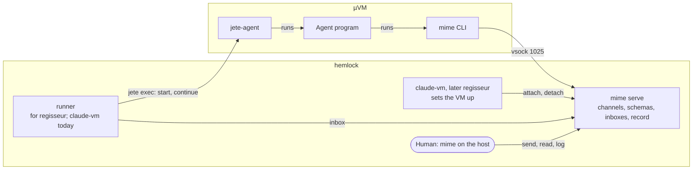

# mime — design

mime is the agent message bus: every message between an agent and the system, the human, or
another agent goes through it. It delivers a message only over a channel the configuration
declares, checks it against its type's schema, rejects it with a reason the sender can act on, and
records it. Its place in the whole is in [architecture.md](../architecture.md#the-bus).

The name is from ballet, like jete's and barre's: mime is the fixed vocabulary of gestures dancers
use to talk to each other on stage, where a gesture outside it means nothing.

## Scope

**Does**

- Take messages from agents, over vsock, and from the human and the system, on the host.
- Know who sent each one from the connection it came on, never from the message (principle 7).
- Accept a message only if a channel allows its type from its sender to its recipient, and its
  body matches the type's schema (principles 4, 5, 6). Otherwise reject it, with the reason.
- Hold accepted messages until their recipient reads them, across restarts.
- Record every message, accepted or rejected, durably (principles 9, 16).

**Does not**

- Run agents, or put messages into a running agent program. The *runner* does that, through each
  program's harness adapter ([architecture.md](../architecture.md#harnesses-plug-and-play)), for
  regisseur; `claude-vm` does it by hand today (see [Delivery](#delivery)).
- Know about roles, tickets or workflows. It's told, per VM, which endpoint the VM is and which
  channels and schemas apply, the way barre is told a VM's rules.
- Read jete's state, or depend on any agent program.
- Act on messages. Rules that react to them (open the pull request on `ready-for-review`) are
  regisseur's.

## Decisions

| Topic | Decision |
|---|---|
| The agent's side | A CLI, `mime`, in the guest image, with a skill that teaches it. Not an MCP server. |
| Transport from the VM | vsock, guest to host, port 1025 (jete-agent has 1024). |
| Identity | The per-VM socket the connection arrives on. A process in the VM can't name its sender. |
| Configuration | Per VM, given at boot from the instance (`mime attach`) by whoever sets the VM up, `claude-vm` now and regisseur later, like barre's rules. mime reads no instance itself. |
| Schemas | JSON Schema, one per message type, in the instance. |
| Delivery into the agent | The runner's job. Between turns, by continuing the agent's session, for every program; optionally, for a program that has one, a live input channel. |
| jete-agent | Unchanged. It stays jete's channel for running commands. |
| Storage | Durable, on the host, in `/var/lib/mime`: an append-only record and an inbox per endpoint. |

### Why a CLI, not an MCP server

The architecture first had a bus shim in each VM presenting the bus as an MCP server. A CLI is
better here, for the same reason the agent uses `git` and `gh` rather than wrapper tools: agents
already know how to run commands.

- **Nothing runs in the VM between messages.** `mime send` connects, sends, prints the outcome and
  exits. There's no daemon beside the agent program to keep alive.
- **Any agent program can use it,** and so can a person in `jete shell` or a test script. An agent
  program only has to run commands (principle 2).
- **It costs context only when used.** A skill's name and description sit in context; its body
  loads when the agent uses it. MCP tool definitions are there in every session. That
  difference is small for four tools; the first two reasons decide it.
- **The rules aren't in the skill.** `mime types` asks the bus what this VM may send, to whom, with
  each schema. The skill teaches the command; the configuration says what it may do.
- **Enforcement doesn't depend on it.** The bus checks every message, however it was sent. An MCP
  front end over the same protocol can come later, for a program that can't run commands.

### Why not jete-agent

jete-agent could carry messages into the VM, but that doesn't solve the hard part: getting a message
into the agent program's conversation, which needs that program's own interface either way. And
jete-agent runs as root and is how the host controls the VM; widening it with message handling
widens the most trusted thing in the guest. jete stays unaware of the bus, as it is of barre
(principle 2). The runner already reaches the agent through `jete exec`; delivery uses that.

## How it fits



### Identity from the socket

Firecracker gives each VM's vsock a host Unix socket in the VM's jail; a guest connection to host
port P arrives at that socket's path with `_P` appended (`v.sock_1025`). Only that VM's
Firecracker can connect there, so a connection on it comes from that VM, whatever the message says.

The jail is readable by the VM's own user alone (mode 0700), so `mime serve`, under its own user,
can't make the socket itself. `mime attach`, run as root when the VM is set up, makes it, gives it to the
VM's user, and passes the listening socket to `mime serve` over its Unix socket. mime serve never
needs access to jete's jails. Any process in the VM can use it: identity is the
VM, not the process, as with barre.

jete exposes where a VM's vsock is (principle 2: it serves bytes, it doesn't read them), so mime
doesn't hard-code jete's jail layout.

### Endpoints and channels

An endpoint is a sender or recipient: an agent (by its VM id, in a role), `human`, or `system`
(regisseur, later). A channel allows message types from one kind of endpoint to another:

```toml
# In instance.toml, given to mime per VM when it's set up.
[mime.types]
question = "mime/question.json"            # JSON Schema files, in the instance repo
answer = "mime/answer.json"
progress = "mime/progress.json"
ready-for-review = "mime/ready-for-review.json"

[[mime.channels]]
from = "worker"
to = "human"
types = ["question", "progress", "ready-for-review"]

[[mime.channels]]
from = "human"
to = "worker"
types = ["answer"]
```

Everything not declared is refused (principle 4). Agent-to-agent channels are the same, between
roles, addressed by the recipient's VM id, which the system gives the sender (in its ticket, say).

### Messages

mime sets the envelope; the sender gives the type, the recipient, references and the body:

```json
{"id": "01JQ…", "at": "2026-11-28T10:04:12Z", "from": "worker:330789ce", "to": "human",
 "type": "question", "refs": ["https://github.com/OWNER/REPO/pull/35"],
 "body": {"text": "README has two install sections. Merge them, or keep both?"}}
```

`refs` point at the artifacts a message concerns (principle 9). A type's schema can require
evidence (principle 11): a `finding` without a source doesn't pass. Bodies are capped (64 KiB to
start).

## The CLI

In the VM, `mime` talks to the bus over vsock:

```bash
mime types                                  # what this VM may send, to whom; each type's schema
mime send question --to human --ref URL <<'EOF'
{"text": "README has two install sections. Merge them, or keep both?"}
EOF
mime inbox                                  # messages waiting; marks them read
mime wait --timeout 600                     # blocks until a message arrives, then prints it
```

`send` prints the message's id, or the reason it was refused (the channel, the schema error and
where in the body), with exit code 1. The skill says when to use each and how to ask a question:
send it, then end the turn (see [Delivery](#delivery)).

On the host, the same binary talks to `mime serve` over a Unix socket that only root can use:

```bash
sudo mime attach ID --as worker < channels.toml    # at boot: listen for the VM
sudo mime detach ID                                # at removal; messages stay recorded
sudo mime send answer --to ID <<<'{"text": "Merge them."}'    # the human
sudo mime inbox --for human
sudo mime log --follow                             # everything, as it happens
```

## Delivery

mime holds a message until its recipient reads it. How it reaches an agent program depends on the
program, so it's the runner's job, configured per program. Two ways, checked with Claude Code in a
VM on hemlock:

1. **Between turns, for every program.** Each turn is a run of the program that exits; the next
   continues the same session with a new prompt (`claude -p --resume ID`, `opencode run
   --continue`, `codex exec resume`). When a turn ends, the runner reads the agent's inbox on the
   host; if messages are waiting, it continues the session with them as the prompt. A message can
   wait for minutes or hours: the session is on disk in the VM. In the check, a second turn, run
   later with `--resume`, remembered what the first was told.
2. **During a run, for a program that has an input channel.** Claude Code with `--input-format
   stream-json` keeps running and reads user messages as JSON lines on stdin. In the check, one
   process took a second message 20 seconds after its first turn ended, in the same session. It's
   Claude Code's own interface, so it's an option for that program, never something the system
   depends on.

Within a turn, an agent can also look itself: `mime inbox` at natural points, or `mime wait` in the
background, which some programs report back to the agent when it returns.

The first prompt is a message too: regisseur sends a new agent a `task` from `system`, pointing at
its ticket, and the runner starts the session with it, as it continues the session with every
later message ([architecture.md](../architecture.md#how-a-ticket-becomes-an-agent)). Until
regisseur, `claude-vm` passes the prompt it's given.

A question works the same in every program: the agent sends it and ends its turn, saying it's
waiting. The runner sees an open question and no answer, and waits; the answer arrives, and the
runner continues the session with it. Nothing interrupts a turn, and nothing is lost while the
agent is busy.

Stopping an agent is the same for every program: the runner ends its `jete exec` session, and
jete-agent kills the program's whole process group. jete's protocol also carries signals (TERM,
INT), for a gentler stop, once the runner needs one.

Each program gets its start and continue commands, and the rest of what the runner needs to know
about it, in a harness adapter, kept in this repo since they're facts about the program, not about a
team ([architecture.md](../architecture.md#harnesses-plug-and-play)). A role names its harness in
the instance.

## Storage

| | Where | What |
|---|---|---|
| Record | `/var/lib/mime/record/<date>.jsonl` | Every message, accepted or rejected (with the reason), in order. Append-only. The bus's log is the record of conversation (principle 9). |
| Inboxes | `/var/lib/mime/inbox/<endpoint>/` | Accepted messages not yet read, one file each, removed when read. Read means `mime inbox` returned it, or the runner delivered it. |
| Attachments | `/run/mime/` | Each attached VM's endpoint and channels. Gone at reboot, like the VMs; a restarted `mime serve` needs the VMs attached again. |

## Running it

Like barre: a static binary installed by Ansible, `mime serve` as a systemd service under its own
user, sandboxed, with only `/var/lib/mime` and `/run/mime` writable. It never opens jete's jails:
it gets each VM's listening socket from `mime attach` (see [Identity from the socket](#identity-from-the-socket)).

## Milestones

| | Goal | Done when |
|---|---|---|
| B1 | Ask the human | On a real ticket, Claude Code in a VM asks the human a question with `mime send`, and ends its turn. The human answers on hemlock with `mime send`. `claude-vm` continues the session with the answer, and the agent finishes the ticket and sends `ready-for-review`. A message of an undeclared type, to an undeclared recipient, or breaking its schema is refused with a reason the agent acts on. Every message is in the record. |
| B2 | Agent to agent | Two VMs in different roles exchange messages over a declared channel, and a channel that isn't declared is refused. |

B1 needs, besides mime: jete telling where a VM's vsock is (today only its library knows); the `mime` binary and its skill in the
guest image; `claude-vm` attaching the VM, delivering between turns and waiting on a question.

## Open questions

1. **Other programs' "continue".** OpenCode's and Codex's continue commands are from their docs, not
   checked. Check each before a role uses it.
2. **Messages during a busy turn** in Claude Code's input channel: queued until the turn ends, as
   expected, or taken in at once. Untested; it decides whether the channel is worth using.
3. **How long a turn may run** before the runner steps in, and how a waiting agent is woken if the
   runner itself restarts. Both are regisseur's at step 7; `claude-vm` waits in the foreground.
4. **Messages for a VM that's gone.** Kept in its inbox for whoever takes over the work, or
   returned to the sender. Depends on how regisseur hands work over.
5. **Storage.** Plain files are enough for one host and a few agents. SQLite, if queries over the
   record or many inboxes need it.
6. **The skill's home.** In the guest image until the skills disk exists (step 9 of the
   [build order](../build-order.md)).
