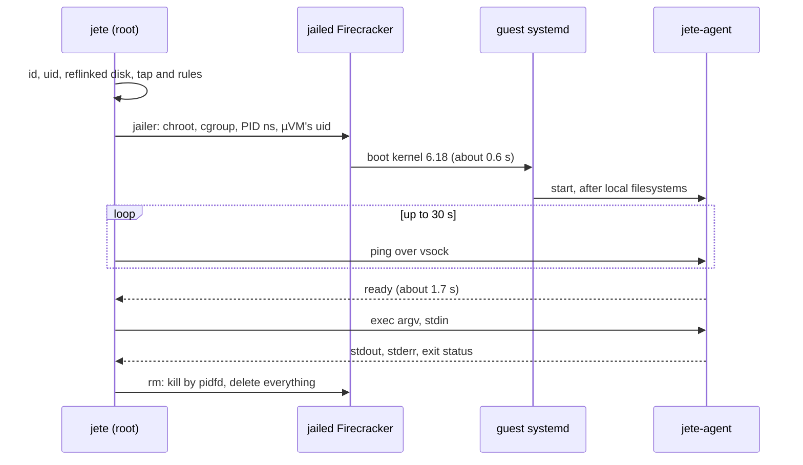
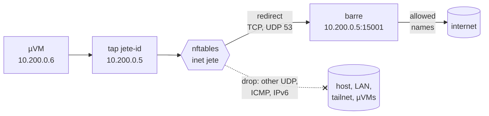
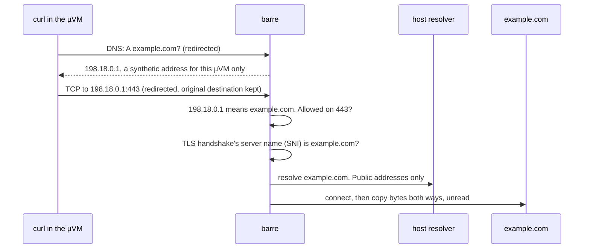
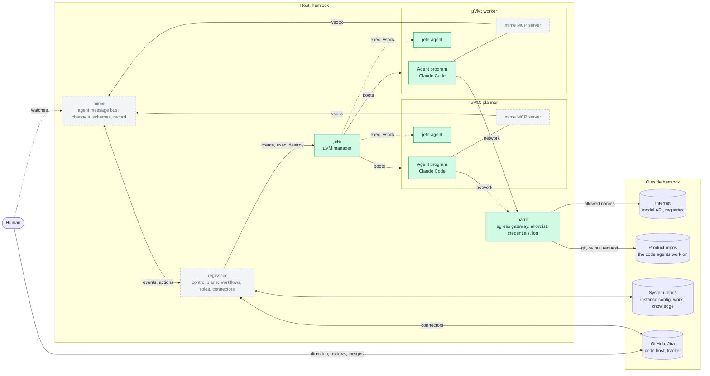

# machinesdancing

<div class="text-3xl pt-2">Firecracker, Rust and Linux</div>
<div class="text-xl opacity-80 pt-1">Building an isolated execution environment for AI agents</div>

<div class="pt-10 text-lg">

**Carlos Westman** · CTO at relativo.io<br/>
Recently moved from Squamish, BC to Bellingham, WA

</div>

:: note ::

Bellingham Linux Users Group, Show and See · 18 November 2026

<!--
Opening, under a minute. Introduce yourself first: Carlos, CTO at relativo.io, new in Bellingham
after moving down from Squamish. Then:

"I'm building infrastructure for running AI agents: each one gets its own small virtual machine,
and everything it sends to the network goes through a gateway that decides, by name, what it may
reach. It runs on a mini PC at home. I'll show you how it works, run it live, and be clear about
what's done and what isn't."

The names are ballet: jeté is a leap (the µVM manager, fast), the barre is the rail dancers hold
(the gateway: something to lean on, and a barrier).
-->

---

# Agenda

<div class="agenda pt-6">
<div class="agenda-part">
<div class="agenda-title">1 · The idea: an architecture</div>
<div>Motivation: how agents run today, and how they should · Design principles · The lab · The stack</div>
</div>
<div class="agenda-part">
<div class="agenda-title">2 · First tools and tests</div>
<div>jete: µVM orchestration, demo · barre: network control, demo · Claude Hello World, demo</div>
</div>
<div class="agenda-part">
<div class="agenda-title">3 · Where it stands</div>
<div>What works · The limits · What's next</div>
</div>
</div>

<!--
Thirty seconds. Set the frame: this talk is about an idea, an architecture for running AI agents,
and the first tools built to test it. Not a finished product. There are demos in the middle. Then
straight into the motivation.
-->

---

# Motivation: how agents run today

<div class="grid grid-cols-2 gap-10 pt-4 items-center">
<div>

<div class="bx bx-host">
<div class="bx-label">Your laptop: one user, one kernel</div>
<div class="bx bx-risk mx-auto text-center" style="width:70%">Claude Code / OpenCode</div>
<div class="bx-prompt mt-2">CLAUDE.md / AGENTS.md: never push to main · update the ticket · don't touch prod · ask first</div>
<div class="pt-2 text-center">
<span class="chip bx-risk">~/.ssh</span>
<span class="chip bx-risk">git credentials</span>
<span class="chip bx-risk">API keys</span>
<span class="chip bx-risk">all your files</span>
<span class="chip bx-risk">the LAN</span>
<span class="chip bx-risk">production</span>
<span class="chip bx-risk">any site</span>
</div>
</div>

</div>
<div>

- More than a year coding with AI agents, side by side in **tmux panes**. It works.
- They run **as me**: everything I can reach, they can reach.
- The rules are a prompt and the **permission prompts** I click through.
- Giving agents access to production, or to your laptop's keys, is a **terrible idea**.

</div>
</div>

<div class="pt-8 text-xl text-center">

**The LLM codes, we prompt for compliance,<br/>and they own our identity and personal information!**

</div>

<!--
This is how most of us run agents today, me included until this project: Claude Code in tmux panes,
as my own user, on my own machine. Everything I can reach, it can reach: my SSH keys, git
credentials, API keys, every file, the LAN, production. The rules are a CLAUDE.md and the
permission prompts I click through. The LLM writes the code, and we prompt it to comply.

And every prompt is friction: someone has to watch the panes. To let agents do more, with fewer
prompts, the limits have to be held from outside the agent.
-->

---

# Motivation: how they should run

<div class="mx-auto pt-3" style="max-width:82%">

<div class="bx bx-host text-sm">
<div class="bx-label">Host: trusted. Every way out of a µVM ends at a host tool that checks it</div>
<div class="bx bx-built" style="padding:0.4rem">
<div class="bx-label" style="padding-bottom:0.2rem">µVM: its own kernel. Nothing inside is trusted</div>
<div class="bx text-center text-sm">Claude Code <span class="text-xs opacity-70">· judgment: plans, codes, reviews</span></div>
<div class="bx-row text-xs">
<div class="bx bx-planned">git, but can't merge to main</div>
<div class="bx bx-planned">skills, read-only</div>
<div class="bx bx-planned">holds minimum keys</div>
<div class="bx bx-planned">agent chat only through an MCP tool</div>
<div class="bx bx-built">guest agent: runs commands inside the µVM</div>
</div>
</div>
<div class="grid grid-cols-3 gap-x-2">
<div class="bx-arrow">↓ network, all of it</div>
<div class="bx-arrow">↓ vsock: identity from the connection</div>
<div class="bx-arrow">↑ vsock: the only way in, host only</div>
<div class="bx bx-built text-center"><b>Network control</b><br/>allowed names only, logged<div class="bx bx-planned mt-1">key injection</div></div>
<div class="bx bx-planned text-center"><b>Controlled chat room</b><br/>declared channels, typed messages, checked, recorded</div>
<div class="bx bx-built text-center"><b>µVM lifecycle</b><br/>a CLI: boot, run commands, destroy</div>
<div class="bx-arrow">↓ model API, product repos</div>
<div class="bx-arrow">↕ requests, events</div>
<div class="bx-arrow">↑ spawn, destroy</div>
</div>
<div class="bx bx-planned text-center"><b>Action and event requests</b>: workflows do the bookkeeping (branches, tickets, PRs); connectors hold GitHub and Jira; a human approves every merge</div>
</div>

</div>

<div class="pt-4 text-xl text-center">

**The LLM codes, the system enforces the rules and guards the secrets.**

</div>

<div class="text-xs opacity-70 pt-2">Green: built. Grey, dashed: designed, not built.</div>

<!--
The design (docs/architecture.md), read top down. Here it's what the system does; the
names come later (network control is barre, the chat room is mime, the lifecycle is jete, action and
event requests are regisseur):
- The agent gets its own µVM: its own kernel, git for the repo it works on (it can push a branch,
  but merging to main is the human's: GitHub enforces it, with a ruleset on main and the human as
  the only code owner, and the agent's GitHub App has no permission to touch CI workflows), its skills on a read-only disk, and the minimum keys: ideally
  none, at most the narrowest one its agent program insists on. It talks to other agents only
  through an MCP tool. A guest agent lets the host run commands inside. Nothing inside the µVM is
  trusted, the agent included.
- Exactly two ways out, both ending at something on the host that checks them. The network: all of
  it goes through network control, which allows names, logs everything, and (later) injects the
  keys on the way out, so the agent never holds them. And vsock to the controlled chat room: only
  declared channels, typed messages, each one checked and recorded. The sender's identity comes
  from which µVM the vsock connection is from, never from what the agent says.
- One way in: the lifecycle's vsock channel to the guest agent, usable only by the host.
- Action and event requests: everything that's the same every time is done by the system (update
  branches, move tickets, open the PR). Its connectors hold the GitHub and Jira credentials. Merges
  need a human, per merge.

The point to land: the LLM still does the creative work. What changes is who holds the rules:
not a prompt the agent can misread or be talked out of, but the host.

Honest status: green is built (the µVM, the lifecycle, network control by name). Today the Claude
Code token is still inside the µVM. "Minimum keys" means: once key injection lands, the µVM holds
none it doesn't have to.

If asked "doesn't Claude Code have a sandbox?": it does, and devcontainers exist. They help. This is
the same idea pushed further: a separate kernel per agent, and a policy the agent can't edit.

The niche, if it fits: an open-source project for running AI agents on-prem, fast and secure.
-->

---

# Design principles

<div class="text-xs opacity-70 pb-3">From <code>PRINCIPLES.md</code>, the seven that matter most today. <span style="color:#059669">●</span> held by what's built.</div>

<div class="text-base tight pt-2">

| | |
|---|---|
| **One µVM per agent** <span style="color:#059669">●</span> | Its own kernel; created for the work, destroyed after |
| **Rules enforced, not prompted** <span style="color:#059669">●</span> | The rules live in the host, never in the prompt |
| **Deny resources by default** <span style="color:#059669">●</span> | Network, files, tools, secrets: granted by role, never implied |
| **Secrets stay outside** | Minimum keys inside; the rest added on the way out |
| **Identity belongs to the system** | From the hypervisor, not the agent's word; declared channels |
| **Judgment to the LLM, procedure to the system** | Workflows do CI, tickets, branch updates |
| **Git is the source of truth** | Work is a PR; tickets, config, skills in git; a human merges |

</div>

<div class="mt-6 p-4 rounded border-l-4 border-emerald-600 bg-emerald-50">

**Agent messages and actions are authorized by a deterministic policy that sits outside the agent, with identity the agent can't forge.**

</div>

<!--
Don't read the table; say the idea, point at the green dots.

The core idea: anything that must hold is enforced by the system (the µVM, the gateway, the bus), not
written in a prompt. An agent can misread an instruction, or be talked out of it by something it read
on the web. The green ones are what the demos show: a µVM per agent, and a network denied by default.
Deny by default is held for the network today; files, tools and secrets come with the rest.

Secrets: today the Claude Code token is inside the µVM. Key injection at the gateway is next.

Judgment and procedure: if a step is the same every time (run CI, hand a ticket over, update a
branch after a merge), the system does it. The LLM gets the parts that need judgment.

The highlighted line is the original part. The pieces exist elsewhere (hooks that approve tool calls,
guardrail rules, workflow engines), but mostly inside the agent's own trust domain. Here the gate is
outside the agent, so a compromised agent can't edit or skip it; identity comes from the hypervisor
(which µVM a vsock connection comes from), so no agent can claim to be another; and authority doesn't
travel, so a denied action can't be laundered through another agent.

Honest limit: a deterministic gate checks form, not meaning. It limits the blast radius; it doesn't
make an agent's ideas good.

If asked "why not containers?": containers aren't "insecure", they share the host's kernel. For code
nobody reviewed, I wanted the kernel boundary too, and Firecracker makes a VM cheap enough to have
one per agent.

PRINCIPLES.md has sixteen; the rest are about agents working as a team (evidence for claims,
procedures as skills, the record), and belong to the parts not built yet.

Git: every piece of work is a pull request, and an open PR is the claim on it. Tickets, the team's
configuration and the skills live in git too, so the record is something you can diff and review.
Merging is the human's: the agent can push a branch, never merge to main.

Source: PRINCIPLES.md (1, 3, 4, 7, 8, 10, 13, 14; wording shortened, secrets drawn from 3 and the
architecture's credentials).
-->

---

# How I work

- **Implementation** developed with Claude Code.
- **Architecture, principles and engineering decisions** are mine.
- **Code reviewed and tested** on real Firecracker microVMs (µVMs).
- **Open source:** the project becomes an open-source project, for running AI agents on-prem, fast and secure, on hardware you own.

<!--
Say it plainly, no apology, then move on. It sets the frame for questions: you can explain why
everything is the way it is; for a line-by-line detail, "I'd rather check the code than guess."

If asked "did AI write all of this?": "The code, yes. The architecture and the decisions are mine, and
I've reviewed and tested what's there. There are details I'm still learning, which is part of why I'm
showing it here."

Open source: this is the bridge to the room. It's built on Linux and open tools (KVM, Firecracker,
nftables, systemd), and it goes back out as open source. Running agents on your own hardware, with
rules you can read, is a very Linux-users-group idea. The repo link is on the last slide.

If asked how a business would work on top: the tools are generic and open source; a team's setup
(its repos, roles, what each may reach, which credentials by name) is an "instance", kept in its own
private repo, never in this one (docs/design/instances.md). Open tools, private configuration, and
services around them.
-->

---

# The lab

<div class="grid grid-cols-[auto_1fr] gap-10 items-center">


<div>

**hemlock**, the black box at the bottom

- HP EliteDesk 800, i5-10500T, 6 cores / 12 threads
- 16 GB RAM, about 12 GB for µVMs
- Ubuntu Server 26.04, kernel 7.0, KVM
- Firecracker and jailer 1.17
- nftables 1.1.6
- On a home LAN, joined to a tailnet

**The Mac builds, hemlock runs**: static musl binaries, copied over SSH by a cargo runner. `cargo test` on the Mac boots real µVMs on hemlock. No compilers on hemlock; Ansible owns its config.

<div class="pt-4 text-sm opacity-70">Cable management: not designed.</div>

</div>
</div>

<!--
A laugh first: point at the black box, "that's where every µVM in this talk runs."

hemlock is configured only by Ansible, from the Mac: nothing on it is set up by hand.

The dev loop: everything targets x86_64-unknown-linux-musl. The runner is a small shell script
(scripts/hemlock-run): binaries are named by content hash, so an unchanged binary isn't sent again.
It means the tests that matter run against real Firecracker µVMs, not mocks.

Sources: docs/design/jete.md (Host), uname, firecracker --version and nft --version on hemlock;
docs/guides/development.md, .cargo/config.toml, scripts/hemlock-run.
-->

---

# The cast

<div class="opacity-80 pb-5">Small tools, each with one job, named from ballet.</div>

<div class="cast">

<ToolIcon name="jete" />
<div><div class="cast-name">jete</div><div class="cast-meaning">jeté: a leap</div></div>
<div>Boots jailed Firecracker µVMs, runs commands, destroys them</div>
<div class="cast-status cast-built">built</div>

<ToolIcon name="jete-agent" />
<div><div class="cast-name">jete-agent</div><div class="cast-meaning">jete's partner, inside each µVM</div></div>
<div>Says the µVM is ready; runs commands for the host, over vsock</div>
<div class="cast-status cast-built">built</div>

<ToolIcon name="barre" />
<div><div class="cast-name">barre</div><div class="cast-meaning">the rail dancers hold</div></div>
<div>Every connection out: allowed by name, or refused; logged</div>
<div class="cast-status cast-built">built</div>

<ToolIcon name="mime" />
<div><div class="cast-name cast-name-planned">mime</div><div class="cast-meaning">the gestures dancers talk with</div></div>
<div>Agent messages: declared channels, checked, recorded</div>
<div class="cast-status cast-planned">not built</div>

<ToolIcon name="regisseur" />
<div><div class="cast-name cast-name-planned">regisseur</div><div class="cast-meaning">runs the show, calls the cues</div></div>
<div>Roles, tickets, workflows; spawns agents through jete</div>
<div class="cast-status cast-planned">not built</div>

</div>

<!--
Introduce the cast: say each name once with its ballet meaning; they come back through the talk. jete and barre are the two that hold the
boundary, and the demos are about them.

Tools, not a monolith, in practice: jete never learns what an agent is; barre never reads jete's state. Each is
usable on its own.

mime will have a small MCP server in each µVM: the agent program sees mime as MCP tools ("send a
message", "read my inbox"), and the server carries them to mime over vsock (shown in "The whole picture", near the end).

The names are ballet: a jeté is a leap; the barre is the rail dancers hold on to; mime is the fixed
vocabulary of gestures dancers use to talk to each other on stage; the régisseur runs the
performances and calls the cues.

Built on: Firecracker and its jailer, KVM, nftables, systemd, Ansible; Claude Code is the first
agent program. All of ours is Rust, about 5,000 lines, started 31 October.

Sources: docs/architecture.md (The tools), crates/.
-->

---

# The stack

<ToolStack />

<div class="text-xs opacity-70 pt-3">Read a column down: what each tool is built on, layer by layer. Green: ours, built. Grey, dashed: ours, not built. White: other people's.</div>

<!--
Read a column down. Each tool is ours; everything under it is Linux and other people's software,
and each piece sits under the tool that actually uses it:

- jete: Firecracker and its jailer on KVM (chroot, cgroup v2, a PID namespace, a uid per µVM); a tap
  per µVM made with ip tuntap, and one nftables table, inet jete, applied with nft -f as one
  transaction; disks as XFS reflinks (the FICLONE ioctl); pidfd_open and pidfd_send_signal to stop a
  µVM without hitting a reused pid; flock to allocate ids and addresses; vsock to the guest, through
  the Unix socket Firecracker exposes on the host (CONNECT <port>).
- barre: doesn't touch nftables at all. jete's rules redirect the µVM's TCP and DNS to barre's port;
  barre reads the original destination with getsockopt(SO_ORIGINAL_DST), answers DNS on UDP 53
  itself, and peeks at the TLS SNI or HTTP Host. It runs as a systemd service: its own user, no
  capabilities, a seccomp filter (@system-service), AF_INET and AF_UNIX only, the filesystem
  read-only. Policies are files root writes in /run/barre; it re-reads them every half second. Its
  log is JSON lines on stdout, which journald keeps.
- mime will reach the µVMs over vsock, like jete.

Both are Rust, about 4,100 lines: tokio for async I/O, rustix for the syscalls (no libc wrappers
written by hand), static musl binaries.

On top, regisseur composes them; it's the only one that will know what an "agent" or a "ticket" is.
Inside each µVM, its own stack: a guest kernel, systemd, jete-agent, and the agent program on top.

Tools, not a monolith: jete could run any workload, barre could front any client.

Sources: Cargo.toml, crates/jete/src/{vm,net,agent}.rs, crates/barre/src/{serve,policy}.rs,
ansible/roles/barre/templates/barre.service.j2.
-->

---
layout: section
---

# First tools and tests

jete, barre, and an agent inside: built and tested on real µVMs

<!--
The switch from the idea to what exists. Everything from here to the status slide is built and
runs on hemlock; the demos are live.
-->

---

# <ToolIcon name="jete" />jete: µVM orchestration

<div class="grid grid-cols-[15rem_1fr] gap-8">
<ToolStack tool="jete" />
<div class="text-sm">

<div class="opacity-80 pb-3">So far: ready in 1.7 s, not tuned yet. About 1 s of that is the guest's systemd.</div>

- **Its own kernel.** The guest runs Linux 6.18, not the host's 7.0: the agent shares no kernel with anything.
- **Jailed twice.** Behind KVM, Firecracker itself is jailed: memory capped at the guest's RAM + 128 MiB.
- **Disks cost nothing.** A reflink copy of a read-only image: instant, blocks shared until written.
- **No network unless asked.** Just `lo`; or, when asked, one exit: barre.
- **Control without a network.** jete-agent answers only the host; if the host hangs up, all it started is killed.
- **A plain guest.** Minimal Ubuntu 26.04 (mmdebstrap, about 120 packages): agents get a normal Linux.

</div>
</div>

<!--
Each µVM gets a random 8-hex id and its own Unix user (from uid 300000). The jail holds a hard link
to the kernel, a reflinked root filesystem, and the config. The cgroup caps memory at guest RAM
plus 128 MiB.

Reflinks: cp --reflink on XFS is instant and shares blocks until written. So the image size barely
matters for boot.

Boot time: about 0.6 s is the kernel, about 1.1 s userspace, almost all of it systemd bringing the
guest up to jete-agent. Nothing has been tuned yet: a trimmed systemd, snapshots and a warm pool
are on the list for when spawning on demand needs them.

Sources: docs/design/jete.md (Stack, M1 plan), crates/jete/src/vm.rs.
-->

---

# A µVM's life



<!--
"Started by the hypervisor" isn't "ready": jete waits for the guest agent's answer on vsock, and
that moment is the time-to-ready it reports. If it never comes (30 s), the µVM is torn down: a
test covers that.

The agent: a 765 KB static Rust binary. One connection is one session; frames are length-prefixed,
JSON for control, raw bytes for data, capped at 1 MiB. It only accepts connections from the host
(vsock CID 2), so a process in the guest can't use it to become root. If the host disconnects, the
whole process group is killed.

Sources: crates/jete/src/vm.rs (wait_ready, READY_TIMEOUT), crates/jete-agent, crates/jete-protocol,
images/rootfs/overlay/etc/systemd/system/jete-agent.service.
-->

---
layout: center
---

# Demo 1: a µVM, start to finish

```bash
id=$(sudo jete run)                                   # prints the id; "ready in N ms"
sudo jete ls
sudo jete exec $id -- uname -sr
sudo jete exec $id -- ls /sys/class/net               # just lo: no network unless asked
sudo jete exec $id -- bash -c "echo hi; exit 3"; echo "exit $?"
sudo jete rm $id
```

<!--
Expected (demos/1-vm-lifecycle.txt has a recorded run):
- ready in about 1720 ms
- Linux 6.18.56+
- lo only
- hi, exit 3: the exit code comes back through vsock
- after rm, the µVM is gone from ls: no jail, cgroup or state left (tests check this).

Point to make: this is a separate kernel, not a process on the host. uname shows the guest's
kernel (6.18), not hemlock's (7.0).

Fallback: show demos/1-vm-lifecycle.txt.
-->

---

# <ToolIcon name="barre" />barre: network control

<div class="grid grid-cols-[15rem_1fr] gap-8">
<ToolStack tool="barre" />
<div class="text-sm">

<div class="opacity-80 pb-3">So far: phase 1, by name. No TLS decryption yet; key injection is next.</div>

- **One exit per µVM.** jete owns isolation, barre the policy. Nothing listening, nothing gets out.
- **The guest can't opt out.** No proxy settings: every TCP connection and DNS query lands on barre.
- **Names, not addresses.** Each allowed name gets a synthetic address; the rest get `NXDOMAIN`.
- **Checked, not read.** By name and port; the TLS SNI or HTTP Host must match; public addresses only.
- **Changed live.** `barre allow` and `revoke` apply within half a second; revoke cuts the µVM off.
- **Every decision on record.** One JSON line per DNS answer and per connection.

</div>
</div>

<!--
The same shape as jete's slide: on the left what it's built on, on the right what that buys.

Ownership was a design correction mid-project: at first jete and the gateway would both have had a
say over the same µVM's traffic. Now a µVM has exactly one exit. Direct (jete run --allow ...):
jete's firewall is the policy, by address, for development and tests. Proxy (jete run
--egress-proxy 15001): all of its traffic goes to one host port, and whatever listens there is the
policy: barre. jete refuses to mix the two, so there's never a question of which one let something
through.

It's the same split as a service mesh (Istio/Envoy): the firewall sends everything to the proxy;
the proxy holds the policy. And the guest needs no proxy settings: it can't opt out.

Sources: docs/design/barre.md (Scope, Who owns what, Phase 2), crates/barre/src,
ansible/roles/barre/templates/barre.service.j2.
-->

---

# How traffic reaches barre



- The kernel keeps each connection's **original destination**; barre reads it with `SO_ORIGINAL_DST`.
- A transparent proxy: the guest doesn't know it's there. If barre isn't listening, nothing gets out.

<!--
Concretely: each µVM gets a /30 from 10.200.0.0/16, host side .1, guest .2. Routed, not bridged.
jete owns one nftables table and touches nothing else (Tailscale's tables stay as they are).

Per µVM: a prerouting chain that redirects its TCP and its UDP port 53 to the proxy port, an input
chain that accepts only that port, a forward chain that drops everything. Packets from any source
address other than the µVM's own are dropped, so barre can trust the source.

Fails closed: jete doesn't know what listens on the port. Nothing listening, nothing reached.

Sources: crates/jete/src/net.rs (BASE_TABLE, PREROUTING, rules), crates/jete/tests/net.rs
(a_proxied_vm_reaches_only_its_proxy).
-->

---

# <ToolIcon name="barre" />barre: names, not addresses



Names not allowed: `NXDOMAIN`, nothing forwarded upstream. A real address works only with an **address rule**.

<!--
Why synthetic addresses: a CDN address serves thousands of sites, so an IP allowlist is either too
broad or breaks. Answering DNS with an address that stands for one name means every connection,
whatever the protocol (HTTPS, git over SSH), tells barre which name it was made for.

198.18.0.0/15 is reserved for benchmarking, never routed on the internet. Addresses are per µVM: one
µVM can't use another's (tested).

Extra checks it can make: on 443 the SNI must match; on 80 the Host header. A name that resolves to
a private address (the LAN, the tailnet, loopback) is refused, so DNS can't aim a µVM at the host's
neighbours. No TLS is decrypted.

Rules look like: example.com, *.githubusercontent.com, github.com:22,443, 140.82.112.0/20:22.
Policies are files in /run/barre/policies, written by root; the service only reads them, as its
own user with no capabilities, under systemd sandboxing.

Sources: docs/design/barre.md, crates/barre/src/serve.rs, rules.rs, dns.rs, peek.rs.
-->

---
layout: center
---

# Demo 2: allowed, and refused

```bash
id=$(sudo barre-vm run example.com github.com:22); sleep 1
sudo jete exec $id -- getent hosts example.com              # 198.18.0.1
sudo jete exec $id -- curl -sI https://example.com | head -1  # HTTP/2 200
sudo jete exec $id -- bash -c 'exec 3<>/dev/tcp/github.com/22; head -1 <&3'   # SSH-2.0-...
sudo jete exec $id -- curl -sS https://github.io            # not resolved
sudo jete exec $id -- curl -sS https://github.com           # 443 not allowed
sudo jete exec $id -- curl -sS https://1.1.1.1              # no rule for the address
sudo jete exec $id -- curl -sS http://192.168.0.1           # the LAN
journalctl -u barre -o cat | grep $id |
  jq -c 'select(.decision=="refuse" or .answer=="NXDOMAIN") | {name, dest, answer, reason}'
sudo nft list table inet jete                               # the rules jete wrote
```

<!--
barre-vm is a short bash script: jete run --egress-proxy 15001, then barre allow with the µVM's
address. The sleep 1 matters: barre picks up a new policy within half a second, and a request
sent before that finds nothing listening and fails. (Known; see the status slide.)

A failed request alone proves nothing: it could be the network, or a typo. The journal says where and why:
  github.io        NXDOMAIN
  github.com 443   name not allowed on this port
  1.1.1.1:443      no rule for this address and port
  192.168.0.1:80   no rule for this address and port

Note the LAN one: in proxy mode, jete hands the connection to barre and barre refuses it. In
direct mode, jete's firewall drops it and the request times out (tested in net.rs).

Last command: the rules that made all of this happen. Next slide walks through them.

Clean up: sudo barre-vm rm $id

Cut for time: changing the policy live (barre allow, barre revoke). If asked, the answer is on the
barre slide: policies apply within half a second, and revoke cuts the µVM off. The recorded run is
in demos/2-egress-policy.txt, "demo 3" part.

Fallback: demos/2-egress-policy.txt.
-->

---

# Demo 2: the rules jete wrote

<div class="grid grid-cols-2 gap-6 text-xs nft-code">
<div>

**Per µVM**: its traffic goes to barre, and only to barre

```bash
chain vm-a6a22748-prerouting {
  ip saddr 10.200.0.2 meta l4proto tcp redirect to :15001
  ip saddr 10.200.0.2 udp dport 53 redirect to :15001
}
chain vm-a6a22748-input {
  ip saddr != 10.200.0.2 drop
  ip daddr 10.200.0.1 meta l4proto { tcp, udp } th dport 15001 accept
  drop
}
chain vm-a6a22748-forward {
  ip saddr != 10.200.0.2 drop
  drop
}
```

</div>
<div>

**Shared**: each tap jumps to its µVM's chains

```bash
map prerouting_vms {
  type ifname : verdict
  elements = { "jete-a6a22748" : jump vm-a6a22748-prerouting }
}
chain prerouting {
  type nat hook prerouting priority dstnat; policy accept;
  iifname "jete-*" iifname vmap @prerouting_vms
}
chain input {
  type filter hook input priority filter; policy accept;
  iifname "jete-*" iifname vmap @input_vms
  iifname "jete-*" drop
}
```

</div>
</div>

<div class="text-sm pt-3">

`sudo nft list table inet jete` on hemlock, trimmed. One table, nothing else on the host touched. Unknown tap: dropped.

</div>

<!--
Real output from hemlock (µVM a6a22748, proxied, policy api.anthropic.com); the live run shows the
demo's own µVM. Trimmed: the forward and input maps, the forward, output and postrouting base
chains (established traffic back to the µVM, and masquerade for direct mode).

Read it top left:
- prerouting: every TCP connection and every DNS query from the µVM's address is redirected to
  port 15001 on the host side of its tap: barre. The guest has no say; no proxy settings anywhere.
- input: only that port on the tap's host address is accepted. Anything with another source
  address is dropped, so a spoofing guest gets nowhere and barre can trust the source.
- forward: nothing is routed for a proxied µVM. Everything leaves through barre or not at all.
- The shared part: one verdict map per hook, keyed by interface name. Adding a µVM is one map
  element and three chains, in one nft -f transaction; removing it is the reverse.
- "jete-*" catch-alls: a tap with no entry in the map is dropped.

Source: crates/jete/src/net.rs (BASE_TABLE, PREROUTING, rules), its unit tests check these lines.
-->

---

# Demo 3: Claude Hello World

<div class="text-sm">

- **Claude Code** in the guest image, run as an unprivileged user `agent`
- Its µVM may reach **`api.anthropic.com`** and nothing else; no permission prompts inside
- The subscription token goes over SSH's stdin: never on a command line or a disk

</div>

<div class="wrap-code pt-2">

```text
$ scripts/claude-vm "Say hello to the BLUG folks!"
ready in 1675 ms
Hello, BLUG folks! 👋 Hope the meetings, the tinkering, and the Linux wrangling are all going well. Happy hacking from me and the user!
vm: 39195192
```

</div>

<div class="text-sm pt-2">

5.8 s end to end, boot included. barre's log for that µVM: three connections, all to `api.anthropic.com`.
**Working, by hand.** Next: a real task, with a repo and a pull request.

</div>

<!--
Run it live, from the Mac; keep the token file off screen. It takes about 6 s. The output shown is
a real run (demos/3-claude-code.txt), the fallback:
  scripts/claude-vm "Say hello to the BLUG folks!"
  ssh hemlock journalctl -u barre -o cat | grep ID     # api.anthropic.com, and nothing else

Honest caveat: the token is inside the µVM while Claude Code runs, so anything in that µVM could use
it, though only toward names the µVM may reach. Phase 2 of barre adds credentials at the gateway, so
the µVM holds none.

Sources: images/rootfs/build, scripts/claude-vm, docs/guides/claude-code.md.
-->

---

# What works today

<div class="text-sm compact">

| Capability | Status | Evidence |
|---|---|---|
| µVM lifecycle, jail, cleanup | Implemented, tested | jete `tests/vm.rs` (3, real µVMs) |
| Readiness and command execution | Implemented, tested | jete `tests/agent.rs` (13) |
| Host, LAN, tailnet, other µVMs unreachable | Implemented, tested | jete `tests/net.rs` (6) |
| DNS and egress by name, logged | Implemented, tested | barre `tests/vm.rs` (2), 21 unit tests |
| IPv6, ICMP, spoofed sources dropped | Implemented, **not tested** | nftables rules in `net.rs` |
| Claude Code in a µVM, behind barre | Tested by hand | `scripts/claude-vm` |
| Repo access, as a GitHub App | **Designed** | `repo-access.md` |
| Credentials kept out of µVMs | **Planned** | barre phase 2 |
| Daemon, snapshots; mime; regisseur | **Planned** | jete M3, M4; not designed |

</div>

<!--
I'd rather show this table than claim "secure". What's tested is tested on real Firecracker µVMs on
hemlock, in the same cargo test run.

Known rough edges:
- The half-second between barre allow and barre listening (demo 2's sleep).
- A connection cut by a revoke isn't logged as closed.
- Policy updates don't affect connections already open.
-->

---

# Known limits

- **Shared hosting.** On 443, barre checks the name in the handshake, then passes bytes it can't read. A client can name an allowed site and ask the same CDN for another one inside ("domain fronting").
- **Encrypted Client Hello.** Hides the real name. Clients need keys from DNS `HTTPS` records, which barre never returns.
- **Other ports aren't inspected.** A name allowed on port 22 can carry anything on port 22.
- **UDP is DNS only.** QUIC falls back to TCP; other UDP protocols don't work.
- **Not hardened, not audited.** One host, one person, a prototype.

<!--
Closing domain fronting needs barre to decrypt TLS. Phase 2 does that, but only for hosts where it
adds credentials (the model API, GitHub), with its own CA that the guest trusts. Everything else
stays pass-through.

Source: docs/design/barre.md (Known limits, Phase 2).
-->

---

# The whole picture

<div class="fit-width">



</div>

<div class="text-sm opacity-80">Green: built. Grey, dashed: designed on paper, not built.</div>

<!--
Where this is going: you've seen the green part working. Now the whole design.

The full design, from docs/architecture.md. Agents never talk to each other or to the outside
directly: each µVM has exactly two ways out, both on the host. Its vsock channel to the bus, and its
network link to the gateway.

What exists today is the green part: jete boots the µVMs, barre is their only way out, and an agent
(Claude Code) runs inside. mime and regisseur, which make it a "team", are next.

Outside hemlock, by who reaches what: agents reach the internet and the product repos only through
barre; regisseur reaches the system's own repos (instance config, work, knowledge) and the code
host and tracker, through its connectors. The repos live on the code host, but each has its own
writers, so each gets its own permissions (docs/architecture.md, Where things are stored).

Source: docs/architecture.md (The picture), with each component's name, jete-agent added, the
outside stores split by who reaches them, and the colours. The agent program is the AI agent (Claude Code); jete-agent is jete's small helper
that runs commands in the µVM.
-->

---

# What's next

<div class="text-2xl pt-4 pb-8">

machinesdancing will be built **by** machinesdancing.

</div>

1. **The first instance:** a private configuration repo for the team that works on this repo
2. **Repo access:** git and `gh` through a GitHub App, credentials per role
3. **Credentials injected by barre:** µVMs hold no secret at all
4. **mime and regisseur:** the "team" part

<!--
Say: "An instance is a team's setup: its repos, its roles, what each may reach. It lives in its own
private repo; the tools stay generic."

The build order is docs/build-order.md. Steps 3 and 4 finish together: a ticket written as for a
person ends in a pull request the human reviews and merges. The first real tickets are on this repo
itself: safe because nothing the agent writes takes effect before the human acts (it can't merge,
hemlock changes only through Ansible, no CI runs its code with secrets), and they start with docs,
scripts and tests, not barre's policy code.

Then open the floor for questions.

Repository: github.com/carloswestman/machinesdancing (on the last slide).
-->

---
layout: default
class: full-photo
---

<div class="photo-credit">Photo: Raimond Spekking, CC BY-SA 4.0, via Wikimedia Commons</div>

<!--
No words. Let the laugh happen, then move on to Thank you.
-->

---
layout: center
class: text-center
---

# Thank you


[github.com/carloswestman/machinesdancing](https://github.com/carloswestman/machinesdancing)

---
layout: section
---

# Backup

---

# Backup: barre's log

```json
{"event":"dns","name":"example.com","type":1,"answer":"198.18.0.1","vm":"399d4349"}
{"event":"connect","name":"example.com","dest":"198.18.0.1:443","decision":"allow",
 "upstream":"172.66.147.243:443","vm":"399d4349"}
{"event":"close","name":"example.com","dest":"198.18.0.1:443","decision":"allow",
 "bytes_up":1930,"bytes_down":5847,"ms":91,"reason":"done","vm":"399d4349"}
{"event":"dns","name":"github.io","type":1,"answer":"NXDOMAIN","vm":"399d4349"}
{"event":"connect","name":"github.com","dest":"198.18.0.2:443","decision":"refuse",
 "reason":"name not allowed on this port","vm":"399d4349"}
```

One JSON line per DNS answer and per connection, to the journal: `journalctl -u barre -o cat`.

<!--
Real lines from demo 2's recorded run (µVM 399d4349), fields reordered, some left out (the address, and the close line's upstream).
-->
