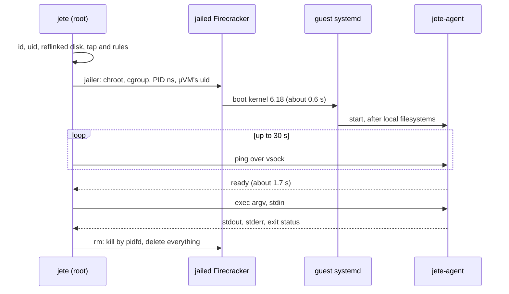
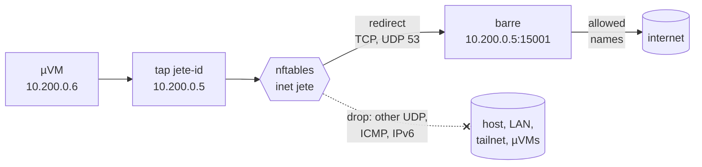
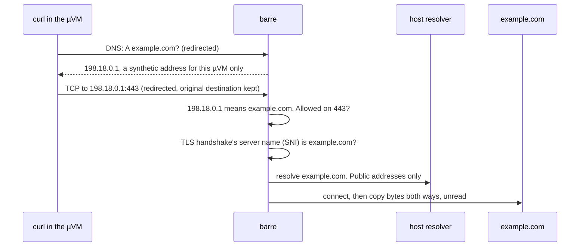

# Firecracker, Rust and Linux

Building an isolated execution environment for AI agents

:: note ::

Carlos Westman · Bellingham Linux Users Group, Show and See · 18 November 2026

<!--
Opening, under a minute:

"I'm building infrastructure for running AI agents: each one gets its own small virtual machine,
and everything it sends to the network goes through a gateway that decides, by name, what it may
reach. It runs on a mini PC at home. I'll show you how it works, run it live, and be clear about
what's done and what isn't."

The names are ballet: jeté is a leap (the µVM manager, fast), the barre is the rail dancers hold
(the gateway: something to lean on, and a barrier).
-->

---

# Why: to learn

- First of all, to **learn**: Firecracker, KVM, nftables and Rust, by building something real.
- A talk at **SeaGL** by the AWS Lambda team on **Firecracker**: I wanted to play with it.
- **Disclosure:** the code is AI-generated, by Claude Code. I've studied it, reviewed it, and tested it on real Firecracker microVMs (µVMs).
- **The architecture is mine:** the principles, the design, and every decision about what gets built and how.

<!--
Firecracker is what AWS Lambda runs on: thousands of short-lived µVMs, each booted in a fraction of a
second. That's the shape agents need too.

The disclosure: say it plainly, no apology, then move on. It sets the frame for questions: you can explain why
everything is the way it is; for a line-by-line detail, "I'd rather check the code than guess."

If asked "did AI write all of this?": "The code, yes. The architecture and the decisions are mine, and
I've reviewed and tested what's there. There are details I'm still learning, which is part of why I'm
showing it here."
-->

---

# Why: the work

- More than a year of coding with AI agents, side by side in **tmux panes**.
- It works. But to let them do more, with less friction and more output, they need **security and strict control**, held from outside the agent.
- Agents with access to production, or to your laptop's keys, is a **terrible idea**.

<!--
The practical reason. Today an agent's limits are mostly instructions and permission prompts, and every
prompt is friction: someone has to watch the panes. If the environment itself holds the limits, the
agent can run with fewer prompts and do more, safely.
-->

---

# The solution

Agents that are **controlled by the system**, not by their instructions:

<div class="grid grid-cols-2 gap-8 pt-2">
<div>

- **Fast and ephemeral**: a µVM per agent, booted in under 2 s, destroyed after
- **Controlled access**: only the network, files and secrets their role grants
- **Controlled tools**: only the tools their role grants
- **Controlled communication**: only declared channels, every message checked and recorded

</div>
<div>

**The LLM decides**: judgment. Planning tickets, writing code, reviewing.

**The system does**: deterministic procedures. CI/CD, ticket handover, branch updates, the bookkeeping.

> We trust agents' judgment, not their compliance.

</div>
</div>

<!--
The core idea: anything that must hold is enforced by the system (the µVM, the gateway, the bus), not
written in a prompt. An agent can misread an instruction, or be talked out of it by something it read
on the web.

And an LLM shouldn't be trusted with what's deterministic: if a step is the same every time (run CI,
hand a ticket over, update a branch after a merge), the system does it. The LLM gets the parts that
need judgment.

Next: these ideas, written down as principles.
-->

---

# Principles

<div class="text-xs opacity-80 pb-2">From <code>PRINCIPLES.md</code>. Every design decision must comply with them. <span style="color:#059669">●</span> held by what's built today.</div>

<div class="grid grid-cols-2 gap-x-6 text-xs principles">
<div>

| | | |
|---|---|---|
| 1 | **Enforced, not requested** <span style="color:#059669">●</span> | What must hold is enforced by the system, never asked of agents |
| 2 | **Tools, not a monolith** <span style="color:#059669">●</span> | Small tools; lower ones know nothing of the layers above |
| 3 | **Isolation** <span style="color:#059669">●</span> | Each agent in its own µVM: a hypervisor, not a shared kernel |
| 4 | **Deny by default** <span style="color:#059669">●</span> | Every resource, peer and message type is granted explicitly |
| 5 | **Strict channels** | Agents talk only over declared channels |
| 6 | **Control before delivery** | Every message and action is checked; refusals give a reason |
| 7 | **Identity belongs to the system** | No claiming identities; a peer's message carries no authority |
| 8 | **Human authority isn't delegable** | Merges, deploys: a human approves each one |

</div>
<div>

| | | |
|---|---|---|
| 9 | **The record is the decision** | Not in git, the code host or the bus log? It didn't happen |
| 10 | **Git-centric** | Work is pull requests; tickets and config live in git |
| 11 | **Claims carry evidence** | A stated fact cites its source |
| 12 | **Procedures are knowledge** | Recurring tasks become versioned skills |
| 13 | **The system runs the lifecycle** | Transitions and bookkeeping are done by the system |
| 14 | **Agents exist on demand** | Spawned for work, destroyed after; events wake them |
| 15 | **Declarative** | Roles, policies, workflows: configuration in git |
| 16 | **Observable** <span style="color:#059669">●</span> | Every message, decision and event is recorded and visible |

</div>
</div>

<!--
This is the hinge of the talk: the problem was "agents need to act, but we can't just ask them to
behave". These are the rules the system holds instead. Everything after this is how.

Don't read them all. Point at the green ones, the ones today's tools hold, and read 1 and 4 aloud:
the demos prove them. The rest are about agents working as a team (channels, approvals, the
record), and belong to mime and regisseur, the bus and the control plane, which aren't built yet.

Source: PRINCIPLES.md (wording shortened).
-->

---

# Why µVMs?

- Agents **run code nobody reviewed**: packages, scripts, whatever a task needs.
- Each agent gets a Firecracker **microVM** (µVM): a real VM with a minimal device model, cheap enough to have one per agent.
- So the boundary is a **hypervisor**, not a shared kernel (principle 3).
- **Deny by default** (principle 4): a µVM reaches nothing unless it's given it.

| Must be able to | Must not be able to |
|---|---|
| Run commands, install things, use files | Reach the host's services |
| Reach the model API, git, registries it's allowed | Reach the LAN, the tailnet, other µVMs |
| Do it fast, disposably | Talk its way past the rules |

<!--
Careful with containers: they're not "insecure", they share the host's kernel. For code we didn't
write, I wanted the kernel boundary too, and Firecracker makes µVMs cheap enough to use one per
agent: it's what AWS Lambda runs on.

Non-goals for now: several hosts, multi-tenant production use, the orchestration layers (they're
designed on paper, not built).
-->

---

# The pieces

<div class="text-sm opacity-80 pb-1">Small tools, each with one job, each knowing nothing about the layers above.</div>

<div class="text-sm">

| Component | What it is | Description |
|---|---|---|
| **jete** | µVM manager | Boots jailed Firecracker µVMs in about 1.7 s, runs commands in them over vsock, gives each a network link or none. *Built.* |
| **jete-agent** | Guest agent | Inside every µVM: says it's ready, runs processes for the host, streams their input and output. *Built.* |
| **barre** | Egress gateway | Every connection a µVM makes goes through it: allowed by name and port, or refused, and logged. *Built (phase 1).* |
| **mime** | Agent message bus | Messages between agents, over declared channels only, checked and recorded. *Not designed.* |
| **regisseur** | Control plane | Roles, tickets, workflows; spawns and destroys agents through jete. *Not designed.* |

</div>

<div class="text-sm opacity-80 pt-2">

**Built on:** Firecracker and its jailer · KVM · nftables · systemd · Ansible · Claude Code, the first agent program. All of ours is Rust, about 5,000 lines, started 31 October.

</div>

<!--
Name each one once; they come back through the talk. jete and barre are the two that hold the
boundary, and the demos are about them.

Principle 2 in practice: jete never learns what an agent is; barre never reads jete's state. Each is
usable on its own.

mime will have a small MCP server in each µVM: the agent program sees mime as MCP tools ("send a
message", "read my inbox"), and the server carries them to mime over vsock (see the next slide).

The names are ballet: a jeté is a leap; the barre is the rail dancers hold on to; mime is the fixed
vocabulary of gestures dancers use to talk to each other on stage; the régisseur runs the
performances and calls the cues.

Sources: docs/architecture.md (The tools), crates/.
-->

---

# The whole picture

<div class="fit-width">


</div>

<div class="text-sm opacity-80">Green: built. Grey, dashed: designed on paper, not built.</div>

<!--
The full design, from docs/architecture.md. Agents never talk to each other or to the outside
directly: each µVM has exactly two ways out, both on the host. Its vsock channel to the bus, and its
network link to the gateway.

What exists today is the green part: jete boots the µVMs, barre is their only way out, and an agent
(Claude Code) runs inside. mime and regisseur, which make it a "team", are next.

Outside hemlock, by who reaches what: agents reach the internet and the product repos only through
barre; regisseur reaches the system's own repos (instance config, work, knowledge) and the code
host and tracker, through its connectors. The repos live on the code host, but each has its own
writers, so each gets its own permissions (docs/architecture.md, Where things are stored).

Source: docs/architecture.md (The picture), with each component's name, jete-agent added, the
outside stores split by who reaches them, and the colours. The agent program is the AI agent (Claude Code); jete-agent is jete's small helper
that runs commands in the µVM.
-->

---

# The lab

<div class="grid grid-cols-[auto_1fr] gap-10 items-center">


<div>

**hemlock**, the black box at the bottom

- HP EliteDesk 800, i5-10500T, 6 cores / 12 threads
- 16 GB RAM, about 12 GB for µVMs
- Ubuntu Server 26.04, kernel 7.0, KVM
- Firecracker and jailer 1.17
- nftables 1.1.6
- On a home LAN, joined to a tailnet

<div class="pt-6 text-sm opacity-70">Cable management: not designed.</div>

</div>
</div>

<!--
A laugh first: point at the black box, "that's where every µVM in this talk runs."

hemlock is configured only by Ansible, from the Mac: nothing on it is set up by hand.

Sources: docs/design/jete.md (Host), uname, firecracker --version and nft --version on hemlock.
-->

---

# The development setup

**The Mac** builds, hemlock runs

- Everything targets `x86_64-unknown-linux-musl`: static binaries
- A **cargo runner** copies each binary to hemlock over SSH and runs it there
- `cargo test` on the Mac boots real µVMs on hemlock
- hemlock has no compilers; Ansible owns its config

<!--
The runner is a small shell script (scripts/hemlock-run): binaries are named by content hash, so
an unchanged binary isn't sent again. It means the tests that matter run against real Firecracker
µVMs, not mocks.

Sources: docs/guides/development.md, .cargo/config.toml, scripts/hemlock-run.
-->

---

# jete: a µVM in 1.7 seconds

| Concern | Choice |
|---|---|
| Hypervisor | **Firecracker** on KVM: minimal device model, written in Rust |
| Jail | Firecracker's **jailer**: chroot, cgroup, PID namespace, its own uid per µVM |
| Disks | **XFS reflinks**: each µVM's disk is a copy-on-write clone of a read-only image |
| Guest | Minimal Ubuntu 26.04 (mmdebstrap), systemd, kernel 6.18 |
| Control | **vsock**: a socket between host and guest that needs no network |
| Network | None by default; a tap device and nftables rules when asked |

<!--
Each µVM gets a random 8-hex id and its own Unix user (from uid 300000). The jail holds a hard link
to the kernel, a reflinked root filesystem, and the config. The cgroup caps memory at guest RAM
plus 128 MiB.

Reflinks: cp --reflink on XFS is instant and shares blocks until written. So the image size barely
matters for boot.

Sources: docs/design/jete.md (Stack, M1 plan), crates/jete/src/vm.rs.
-->

---

# A µVM's life



<!--
"Started by the hypervisor" isn't "ready": jete waits for the guest agent's answer on vsock, and
that moment is the time-to-ready it reports. If it never comes (30 s), the µVM is torn down: a
test covers that.

The agent: a 765 KB static Rust binary. One connection is one session; frames are length-prefixed,
JSON for control, raw bytes for data, capped at 1 MiB. It only accepts connections from the host
(vsock CID 2), so a process in the guest can't use it to become root. If the host disconnects, the
whole process group is killed.

Sources: crates/jete/src/vm.rs (wait_ready, READY_TIMEOUT), crates/jete-agent, crates/jete-protocol,
images/rootfs/overlay/etc/systemd/system/jete-agent.service.
-->

---
layout: center
---

# Demo 1: a µVM, start to finish

```bash
id=$(sudo jete run)                                   # prints the id; "ready in N ms"
sudo jete ls
sudo jete exec $id -- uname -sr
sudo jete exec $id -- ls /sys/class/net               # just lo: no network unless asked
sudo jete exec $id -- bash -c "echo hi; exit 3"; echo "exit $?"
sudo jete rm $id
```

<!--
Expected (demos/1-vm-lifecycle.txt has a recorded run):
- ready in about 1720 ms
- Linux 6.18.56+
- lo only
- hi, exit 3: the exit code comes back through vsock
- after rm, the µVM is gone from ls: no jail, cgroup or state left (tests check this).

Point to make: this is a separate kernel, not a process on the host. uname shows the guest's
kernel (6.18), not hemlock's (7.0).

Fallback: show demos/1-vm-lifecycle.txt.
-->

---

# The network: one owner per µVM's egress

A µVM's network has two concerns. Each has **exactly one** owner.

| | Owner | Guarantees |
|---|---|---|
| **Isolation** | jete | The µVM's traffic leaves only through the exit chosen. Never the host's services, the LAN, the tailnet, other µVMs. Nothing connects in. |
| **Egress policy** | the exit | What it may reach beyond that, and the record of it. |

jete offers two exits, and a µVM gets **one**:

- **Direct**: `jete run --allow 1.1.1.1 --dns 1.1.1.1`. jete's firewall is the policy, by address.
- **Proxy**: `jete run --egress-proxy 15001`. **All** of its traffic goes to one host port. Whatever listens there is the policy: barre.

<!--
This was a design correction mid-project: at first jete and the gateway would both have had a say
over the same µVM's traffic. Splitting it like this means there's never a question of which one
let something through. jete refuses to mix the two.

It's the same split as a service mesh (Istio/Envoy): the firewall sends everything to the proxy;
the proxy holds the policy. And the guest needs no proxy settings: it can't opt out.

Source: docs/design/barre.md (Who owns what).
-->

---

# How traffic reaches barre



- The kernel keeps each connection's **original destination**; barre reads it with `SO_ORIGINAL_DST`.
- A transparent proxy: the guest doesn't know it's there. If barre isn't listening, nothing gets out.

<!--
Concretely: each µVM gets a /30 from 10.200.0.0/16, host side .1, guest .2. Routed, not bridged.
jete owns one nftables table and touches nothing else (Tailscale's tables stay as they are).

Per µVM: a prerouting chain that redirects its TCP and its UDP port 53 to the proxy port, an input
chain that accepts only that port, a forward chain that drops everything. Packets from any source
address other than the µVM's own are dropped, so barre can trust the source.

Fails closed: jete doesn't know what listens on the port. Nothing listening, nothing reached.

Sources: crates/jete/src/net.rs (BASE_TABLE, PREROUTING, rules), crates/jete/tests/net.rs
(a_proxied_vm_reaches_only_its_proxy).
-->

---

# barre: names, not addresses



Names not allowed: `NXDOMAIN`, nothing forwarded upstream. A real address works only with an **address rule**.

<!--
Why synthetic addresses: a CDN address serves thousands of sites, so an IP allowlist is either too
broad or breaks. Answering DNS with an address that stands for one name means every connection,
whatever the protocol (HTTPS, git over SSH), tells barre which name it was made for.

198.18.0.0/15 is reserved for benchmarking, never routed on the internet. Addresses are per µVM: one
µVM can't use another's (tested).

Extra checks it can make: on 443 the SNI must match; on 80 the Host header. A name that resolves to
a private address (the LAN, the tailnet, loopback) is refused, so DNS can't aim a µVM at the host's
neighbours. No TLS is decrypted.

Rules look like: example.com, *.githubusercontent.com, github.com:22,443, 140.82.112.0/20:22.
Policies are files in /run/barre/policies, written by root; the service only reads them, as its
own user with no capabilities, under systemd sandboxing.

Sources: docs/design/barre.md, crates/barre/src/serve.rs, rules.rs, dns.rs, peek.rs.
-->

---
layout: center
---

# Demo 2: allowed, and refused

```bash
id=$(sudo barre-vm run example.com github.com:22); sleep 1
sudo jete exec $id -- getent hosts example.com              # 198.18.0.1
sudo jete exec $id -- curl -sI https://example.com | head -1  # HTTP/2 200
sudo jete exec $id -- bash -c 'exec 3<>/dev/tcp/github.com/22; head -1 <&3'   # SSH-2.0-...
sudo jete exec $id -- curl -sS https://github.io            # not resolved
sudo jete exec $id -- curl -sS https://github.com           # 443 not allowed
sudo jete exec $id -- curl -sS https://1.1.1.1              # no rule for the address
sudo jete exec $id -- curl -sS http://192.168.0.1           # the LAN
journalctl -u barre -o cat | grep $id |
  jq -c 'select(.decision=="refuse" or .answer=="NXDOMAIN") | {name, dest, answer, reason}'
```

<!--
barre-vm is a short bash script: jete run --egress-proxy 15001, then barre allow with the µVM's
address. The sleep 1 matters: barre picks up a new policy within half a second, and a request
sent before that finds nothing listening and fails. (Known; see the status slide.)

A failure alone proves nothing (your plan's point). The journal says where and why:
  github.io        NXDOMAIN
  github.com 443   name not allowed on this port
  1.1.1.1:443      no rule for this address and port
  192.168.0.1:80   no rule for this address and port

Note the LAN one: in proxy mode, jete hands the connection to barre and barre refuses it. In
direct mode, jete's firewall drops it and the request times out (tested in net.rs).

Fallback: demos/2-egress-policy.txt.
-->

---
layout: center
---

# Demo 3: change the rules, not the µVM

```bash
sudo jete exec $id -- curl -sS https://1.1.1.1              # refused
addr=$(sudo barre ls | awk -v id=$id '$2==id{print $1}')
sudo barre allow $addr --vm $id example.com github.com:22 1.1.1.1; sleep 1
sudo jete exec $id -- curl -sI https://1.1.1.1 | head -1    # HTTP/2 301
sudo barre revoke $addr; sleep 1
sudo jete exec $id -- curl -sS https://example.com          # could not resolve
sudo barre-vm rm $id
```

<!--
The guest isn't touched and doesn't cooperate: the policy lives on the host. allow replaces the
whole policy; barre applies it within half a second. Changed rules apply to new connections;
revoking stops the µVM's listeners and closes its open connections.

A policy records the interface its address was on, by name and index. When jete removes the µVM the
interface goes, so a forgotten policy can never pass to the next µVM given the same address (tested).

Fallback: demos/2-egress-policy.txt, "demo 3" part.
-->

---

# An agent inside: Claude Code

- The guest image includes **Claude Code**, run as an unprivileged user `agent`.
- `scripts/claude-vm "PROMPT"` boots a µVM that may reach **`api.anthropic.com`** and nothing else, then runs the prompt.
- No permission prompts inside: the µVM and barre contain it, not the agent's own checks.
- The subscription token goes over SSH's stdin into its environment: never on a command line or a disk.

**Status: working, by hand.** Prompts run on a real subscription. barre's log shows these µVMs reaching `api.anthropic.com` and nothing else. Next: a real task, with a repo and a pull request.

<!--
Optional live demo (it works with a real token; keep the token file off screen):
  scripts/claude-vm "what is in your home directory?"
  ssh hemlock journalctl -u barre -o cat | grep ID     # api.anthropic.com, and nothing else

Honest caveat: the token is inside the µVM while Claude Code runs, so anything in that µVM could use
it, though only toward names the µVM may reach. Phase 2 of barre adds credentials at the gateway, so
the µVM holds none.

Sources: images/rootfs/build, scripts/claude-vm, docs/guides/claude-code.md.
-->

---

# What works today

<div class="text-sm">

| Capability | Status | Evidence |
|---|---|---|
| µVM lifecycle, jail, cleanup | Implemented, tested | jete `tests/vm.rs` (3, real µVMs) |
| Readiness and command execution | Implemented, tested | jete `tests/agent.rs` (13) |
| Host, LAN, tailnet, other µVMs unreachable | Implemented, tested | jete `tests/net.rs` (6) |
| DNS and egress by name, logged | Implemented, tested | barre `tests/vm.rs` (2), 21 unit tests |
| IPv6, ICMP, spoofed sources dropped | Implemented, **not tested** | nftables rules in `net.rs` |
| Claude Code in a µVM, behind barre | Implemented, tested by hand | `scripts/claude-vm`; barre's log |
| Credentials kept out of µVMs | **Planned** | barre phase 2 |
| Daemon, snapshots; mime; regisseur | **Planned** | jete M3, M4; not designed |

</div>

<!--
I'd rather show this table than claim "secure". What's tested is tested on real Firecracker µVMs on
hemlock, in the same cargo test run.

Known rough edges:
- The half-second between barre allow and barre listening (demo 2's sleep).
- A connection cut by a revoke isn't logged as closed.
- Policy updates don't affect connections already open.
-->

---

# Known limits

- **Shared hosting.** On 443, barre checks the name in the handshake, then passes bytes it can't read. A client can name an allowed site and ask the same CDN for another one inside ("domain fronting").
- **Encrypted Client Hello.** Hides the real name. Clients need keys from DNS `HTTPS` records, which barre never returns.
- **Other ports aren't inspected.** A name allowed on port 22 can carry anything on port 22.
- **UDP is DNS only.** QUIC falls back to TCP; other UDP protocols don't work.
- **Not hardened, not audited.** One host, one person, a prototype.

<!--
Closing domain fronting needs barre to decrypt TLS. Phase 2 does that, but only for hosts where it
adds credentials (the model API, GitHub), with its own CA that the guest trusts. Everything else
stays pass-through.

Source: docs/design/barre.md (Known limits, Phase 2).
-->

---

# How it's built

- **AI-generated code, my architecture**, as I said at the start: Claude Code writes; I design, review and test.
- **Design first.** Each tool has a design doc with milestones and "done when" commands, written before the code.
- **Real tests.** `cargo test` on the Mac boots Firecracker µVMs on hemlock. Every claim on the status slide points at one.
- **Branch, pull request, review, merge.** Hosts change only through Ansible.

<!--
A detail that went wrong and got caught by running it on real µVMs makes a good story here, e.g. the
demo-2 race, or an address-reuse test that needed tests to run one at a time.
-->

---

# Next, and questions for you

**Next**
- A real task, end to end: Claude Code in a µVM, a git repo, a pull request
- Credentials added by barre, so µVMs hold none
- jete: a daemon with an API; snapshots and a warm pool for instant µVMs
- mime, the agent message bus, and regisseur, the control plane: the "team" part

**I'd value your take on**
- Would you trust a transparent proxy, or rather an explicit one?
- Domain fronting: decrypt, or live with it?
- What would you test to try to get out of one of these µVMs?

<!--
Pick two of the three questions, depending on time. End on the question; don't summarize.

Repository: github.com/carloswestman/machinesdancing (on the last slide).
-->

---
layout: center
class: text-center
---

# Thank you

[github.com/carloswestman/machinesdancing](https://github.com/carloswestman/machinesdancing)

---
layout: section
---

# Backup

---

# Backup: a proxied µVM's nftables rules

```bash
# Base table, created once (excerpt): each tap goes to its µVM's chains
chain prerouting { type nat hook prerouting priority dstnat; iifname vmap @prerouting_vms }
chain input      { ...; iifname "jete-*" iifname vmap @input_vms;   iifname "jete-*" drop }
chain forward    { ...; iifname "jete-*" iifname vmap @forward_vms; iifname "jete-*" drop }

# Per µVM, proxy mode on port 15001
add rule inet jete vm-<id>-prerouting ip saddr 10.200.0.2 meta l4proto tcp redirect to :15001
add rule inet jete vm-<id>-prerouting ip saddr 10.200.0.2 udp dport 53 redirect to :15001
add rule inet jete vm-<id>-input ip saddr != 10.200.0.2 drop
add rule inet jete vm-<id>-input ip daddr 10.200.0.1 meta l4proto { tcp, udp } th dport { 15001 } accept
add rule inet jete vm-<id>-forward ip saddr != 10.200.0.2 drop
add rule inet jete vm-<id>-forward drop
```

<!--
Live: sudo nft list table inet jete

Source: crates/jete/src/net.rs, and its unit tests, which check these exact lines.
-->

---

# Backup: barre's log

```json
{"event":"dns","name":"example.com","type":1,"answer":"198.18.0.1","vm":"399d4349"}
{"event":"connect","name":"example.com","dest":"198.18.0.1:443","decision":"allow",
 "upstream":"172.66.147.243:443","vm":"399d4349"}
{"event":"close","name":"example.com","dest":"198.18.0.1:443","decision":"allow",
 "bytes_up":1930,"bytes_down":5847,"ms":91,"reason":"done","vm":"399d4349"}
{"event":"dns","name":"github.io","type":1,"answer":"NXDOMAIN","vm":"399d4349"}
{"event":"connect","name":"github.com","dest":"198.18.0.2:443","decision":"refuse",
 "reason":"name not allowed on this port","vm":"399d4349"}
```

One JSON line per DNS answer and per connection, to the journal: `journalctl -u barre -o cat`.

<!--
Real lines from demo 2's recorded run (µVM 399d4349), fields reordered, some left out (the address, and the close line's upstream).
-->
